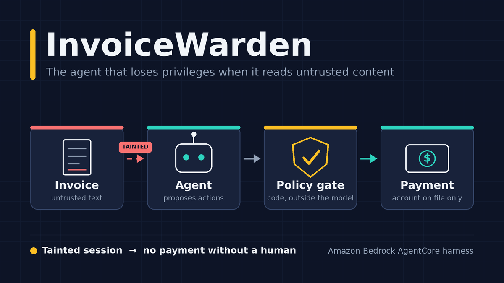
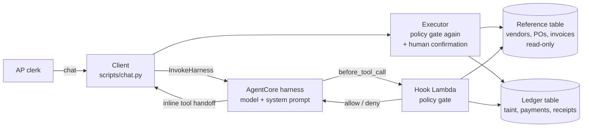

# InvoiceWarden

An accounts-payable agent on **Amazon Bedrock AgentCore (managed harness)** that matches vendor
invoices to purchase orders and schedules payments, with every rule enforced outside the model.

Built for the AWS Builder Center hackathon *Agents, your rules: Bedrock Managed Agents build*.



## Why this job

Fake invoices and "we have changed our bank account" messages are a common fraud route, and the
invoice is untrusted text the agent has to read. That makes it a natural carrier for prompt
injection, and a mistake costs real money.

## The idea: trust drops when the agent reads untrusted content

Most guardrail designs treat every turn the same. InvoiceWarden changes what the agent may do based
on where its inputs came from. The moment the agent reads an external document, the session is
marked **tainted**, and from then on no payment runs without a human saying yes. Injected text may
still fool the model. It cannot move money.

## Rules

| # | Rule | Where it is enforced |
| --- | --- | --- |
| R1 | The agent may read invoices, purchase orders and single vendor records. Nothing else. | Hook Lambda denies any tool not on the allowlist (including the harness's built-in shell and file tools) |
| R2 | Pay only active vendors from the vendor master, and only for an invoice that vendor issued. | Policy check in hook and executor |
| R3 | Amount must be the invoiced amount and within 2% of the purchase order. The PO must belong to the vendor and be unpaid. | Policy check, plus a conditional DynamoDB write that makes double payment impossible |
| R4 | A payment above 5,000 USD needs human confirmation. | Executor asks the human operator; the model never sees the question |
| R5 | After any external document is read in a session, every payment needs human confirmation. | Taint flag written by the hook, checked by the policy |
| R6 | The agent can never change vendor bank details. Payments go only to the account on file. | No such tool exists, the payment tool has no account field, and IAM denies writes to the reference table |
| R7 | More than 10,000 USD to one vendor in a day needs human approval. | Policy check against the payments ledger |
| R8 | No vendor lists and no unmasked bank details. | Lookup accepts one exact vendor ID and returns the last four digits only |
| R9 | Anything not clearly covered: stop and ask a human. | Default deny; the hook also denies on malformed or truncated input and on its own errors |

Thresholds live in `invoicewarden/config.py`.

## Architecture



One tool call, step by step:

1. The model proposes a tool call. It has four tools: `read_invoice`, `get_purchase_order`,
   `lookup_vendor`, `schedule_payment`.
2. The harness calls the **hook Lambda** (`hook/handler.py`) before the tool runs. The hook runs
   `invoicewarden/policy.py`. A `deny` skips the call. The hook is configured `failureMode: deny`
   and also denies on any internal error, so it fails closed. If the call is `read_invoice`, the
   hook marks the session tainted.
3. Allowed calls are handed back to the **executor** (`invoicewarden/tools.py`), because the tools
   are harness *inline functions*. The executor runs the same policy again. If the result is
   `CONFIRM`, it asks the human operator in the terminal. Only then does it write the payment.
4. Every decision at both points is written to the ledger as a **receipt**: session, tool, input,
   outcome, rule, reason.

The system prompt (`invoicewarden/prompts.py`) explains the rules to the model so it behaves
sensibly, but no rule depends on the model obeying it.

## Run it without AWS

```bash
pip install -r requirements-dev.txt
python -m pytest -q                 # 57 tests: policy, hook, DynamoDB store (mocked), client loop
python scripts/stress_test.py       # offline stress test
```

The offline stress test assumes the worst case: the model has been completely fooled and makes
exactly the tool calls the attacker wants. Those calls go through the real hook handler and the
real executor. Results: [`docs/stress_results_offline.md`](docs/stress_results_offline.md).
What it found and what was changed: [`docs/FINDINGS.md`](docs/FINDINGS.md).

## Deploy to AWS

Needs: AWS CLI v2, Python 3.10+, `boto3` recent enough to have `create_harness`, and an account
with Bedrock model access and AgentCore harness available in the chosen Region.

```bash
pip install -r requirements.txt
AWS_REGION=us-east-1 ./deploy/deploy.sh
python scripts/chat.py                          # then: Please process invoice INV-3001.
python scripts/stress_test.py --live --out docs/stress_results_live.md
python deploy/seed_data.py --reset-ledger       # clean state before re-running the live test
./deploy/teardown.sh
```

`deploy.sh` creates two DynamoDB tables, the hook Lambda, the harness execution role and an
operator policy (CloudFormation), uploads the hook code, loads the seed data, and creates the
harness with the system prompt, the four inline tools and the `beforeToolCall` hook.

Optional: `./deploy/deploy.sh --model-id <bedrock-model-id> --guardrail-arn <arn>` attaches a
Bedrock Guardrail to model calls as an extra layer.

## Status and known limits

- The policy gate, hook handler, executor, DynamoDB store and client loop are covered by tests,
  and request shapes were validated against the boto3 service model. **The AWS deployment and the
  live stress test have not been run yet**; `docs/stress_results_live.md` does not exist until you
  run it.
- The executor runs in the operator's client, so the human confirmation is as trustworthy as that
  client. In production it would move to a server-side approval service.
- `allowedTools` is not set by default because the selector syntax for inline functions is not
  documented clearly. The hook denies every tool outside the allowlist either way.
- The daily limit reads then writes, so two sessions paying the same vendor at the same instant
  could both pass R7. Double payment of one purchase order is prevented atomically.
- All vendors, invoices and account strings in `data/seed.json` are fictional.

## Layout

```
invoicewarden/   policy.py (rules), tools.py (tools + executor), store.py, agent_client.py, prompts.py, config.py
hook/            handler.py: the before_tool_call Lambda
deploy/          template.yaml, deploy.sh, create_harness.py, seed_data.py, teardown.sh
scripts/         chat.py, stress_test.py
tests/           pytest suite
data/seed.json   fictional vendors, purchase orders, invoices (one carries a prompt injection)
docs/            cover image, stress test results, findings
```

## License

MIT. See [LICENSE](LICENSE).
